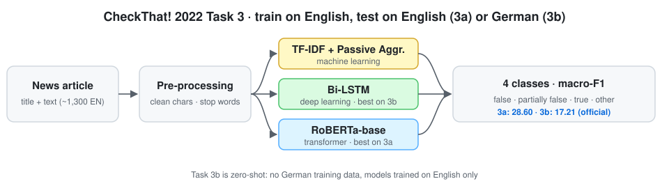

<div align="center">

# Multi-Class and Cross-Lingual Fake News Detection
### CIC at CheckThat! 2022 — Task 3a (English) and Task 3b (English → German)

[](https://ceur-ws.org/Vol-3180/paper-33.pdf)
[](https://checkthat.gitlab.io/clef2022/task3/)
[](#installation)
[](LICENSE)
[](https://github.com/marif561/Multi-Class-Fake-News-Detection/actions/workflows/tests.yml)

Code and results for **"CIC at CheckThat!-2022: Multi-class and Cross-lingual Fake News Detection"**, *Working Notes of CLEF 2022*, CEUR Workshop Proceedings Vol-3180, pp. 434–443.

**Muhammad Arif** · Atnafu Lambebo Tonja · Iqra Ameer · Olga Kolesnikova · Alexander Gelbukh · Grigori Sidorov · Abdul Gafar Manuel Meque

*Centro de Investigación en Computación, Instituto Politécnico Nacional (CIC-IPN), Mexico City*

</div>

---

## About the paper

Fake news spreads quickly online and can do real social and political harm, so detecting it automatically matters. This paper describes the CIC team's entry to **CheckThat! 2022 Task 3**. The task is to classify a full news article as **false**, **partially false**, **true** or **other**. **Task 3a** is monolingual (English), and **Task 3b** is cross-lingual: train on English, test on German. We compare a machine-learning model (Passive Aggressive Classifier on TF-IDF), a deep-learning model (Bi-LSTM) and a transformer (RoBERTa). RoBERTa scored best on English, with a **macro-F1 of 28.60%**, and Bi-LSTM transferred better to German.

<p align="center">
  
</p>

## The task

| Label | Meaning |
|---|---|
| **false** | The main claim of the article is untrue |
| **partially false** | The article mixes true and false content and cannot be considered fully true |
| **true** | The main claim is accurate |
| **other** | Not enough evidence to put the article in any of the categories above |

The training data has about **1,300 English articles** (ID, title, text, label). It is imbalanced: false 46%, partially false 28%, true 17%, other 9%. Macro-F1 is the official metric.

## Models

| Family | Model | Key settings |
|---|---|---|
| Machine learning | **Passive Aggressive Classifier** | TF-IDF (`max_df` 0.7) · C 0.5 · 50 iterations |
| Deep learning | **Bi-LSTM** | 100-d embeddings · 128 units · dense 256 · dropout 0.2 · Adam 1e-4 · batch 32 · 50 epochs |
| Transformer | **RoBERTa-base** | softmax head · dropout 0.1 · Adam 1e-4 · batch 32 · 20 epochs |

Preprocessing removes unwanted characters and stop words and maps labels to integers. Full settings are in [`configs/`](configs/).

## Results

As reported in the paper's Table 3. All scores are macro-averaged except accuracy.

| Task | Model | Accuracy | Precision | Recall | F1 |
|---|---|:-:|:-:|:-:|:-:|
| **3a** English | Passive Aggressive | 0.51 | 0.29 | 0.25 | 0.20 |
| | Bi-LSTM | **0.52** | 0.13 | 0.25 | 0.17 |
| | **RoBERTa** | 0.47 | **0.36** | **0.34** | **0.29** |
| **3b** English → German | Passive Aggressive | – | – | – | – |
| | **Bi-LSTM** | **0.61** | **0.37** | **0.39** | **0.35** |
| | RoBERTa | 0.28 | 0.13 | 0.26 | 0.17 |

**Official submissions (abstract):** Task 3a macro-F1 **28.60%** (RoBERTa), Task 3b macro-F1 **17.21%**.

> **Reading the table.** The abstract credits the 17.21% Task 3b score to Bi-LSTM, but in Table 3 that value matches the RoBERTa row, and Bi-LSTM shows 0.35. The paper doesn't say whether Table 3 comes from validation or test data. Both tables are kept as published in [`results/`](results/).

**Takeaways**

- Accuracy is misleading here. Bi-LSTM gets the best 3a accuracy (0.52) just by predicting the majority `false` class, so its macro-F1 is only 0.17.
- On a small, imbalanced English set, RoBERTa is the only model that spreads predictions across the classes.
- Cross-lingual transfer with an English-only model is hard. Multilingual encoders (mBERT, XLM-R) are the natural next step and are supported by `train_transformer.py`.

## Repository structure

```
.
├── configs/                 # Hyperparameters from the paper
├── data/                    # Expected format + tiny invented EN/DE samples
├── docs/figures/            # Pipeline diagram
├── results/                 # Paper results as CSV
├── scripts/run_all.sh       # Run all models for Task 3a and 3b
├── tests/                   # Unit tests (CI on every push)
└── src/fakenews/
    ├── data.py              # Loading CheckThat! files, label mapping
    ├── preprocess.py        # Character cleaning + stop-word removal
    ├── metrics.py           # Accuracy, macro P/R/F1, per-class report
    ├── train_pac.py         # TF-IDF + Passive Aggressive Classifier
    ├── train_bilstm.py      # Bi-LSTM (PyTorch)
    └── train_transformer.py # RoBERTa (or any multilingual encoder)
```

## Installation

```bash
git clone https://github.com/marif561/Multi-Class-Fake-News-Detection.git
cd Multi-Class-Fake-News-Detection
python -m venv .venv && source .venv/bin/activate
pip install -r requirements.txt
pip install -e .
```

## Data

The CheckThat! 2022 Task 3 data comes from the [organisers](https://checkthat.gitlab.io/clef2022/task3/) and is not redistributed here. See [`data/README.md`](data/README.md) for the expected columns. The defaults match the official files: `title`, `text`, `our rating`.

## Usage

```bash
# Task 3a: train on English, evaluate on English
python -m fakenews.train_pac         --train data/en/train.csv --dev data/en/dev.csv --test data/en/test.csv
python -m fakenews.train_bilstm      --train data/en/train.csv --dev data/en/dev.csv --test data/en/test.csv
python -m fakenews.train_transformer --train data/en/train.csv --dev data/en/dev.csv --test data/en/test.csv

# Task 3b: same English training data, German test set
python -m fakenews.train_bilstm      --train data/en/train.csv --dev data/en/dev.csv \
                                     --test data/de/test.csv --test-lang de

# Try a multilingual encoder for 3b
python -m fakenews.train_transformer --model xlm-roberta-base --train data/en/train.csv \
                                     --dev data/en/dev.csv --test data/de/test.csv --test-lang de
```

Or run everything with `bash scripts/run_all.sh data`. Each run writes metrics and test predictions to `outputs/`.

> **Note.** `src/` is a clean reference implementation of the setup in the paper; the original Bi-LSTM was built in Keras and this version uses PyTorch. Scores can differ with data splits, library versions and seeds. Where the paper looks inconsistent, the code makes the standard choice and the config says so. For example, it uses multi-class cross-entropy where the paper mentions binary cross-entropy.

## Citation

```bibtex
@inproceedings{arif2022cic,
  title     = {{CIC} at {CheckThat!-2022}: Multi-class and Cross-lingual Fake News Detection},
  author    = {Arif, Muhammad and Tonja, Atnafu Lambebo and Ameer, Iqra and Kolesnikova, Olga and
               Gelbukh, Alexander and Sidorov, Grigori and Meque, Abdul Gafar Manuel},
  booktitle = {Working Notes of {CLEF} 2022 -- Conference and Labs of the Evaluation Forum},
  series    = {CEUR Workshop Proceedings},
  volume    = {3180},
  pages     = {434--443},
  year      = {2022},
  url       = {https://ceur-ws.org/Vol-3180/paper-33.pdf}
}
```

## Acknowledgements

Partially supported by CONACYT grant A1-S-47854, SIP-IPN grants 20220852, 20220859 and 20221627, the Deep Learning Platform for Language Technologies at INAOE, and the Microsoft Latin America PhD Award.

## License

Code is released under the [MIT License](LICENSE). The CheckThat! data is subject to the organisers' terms.
